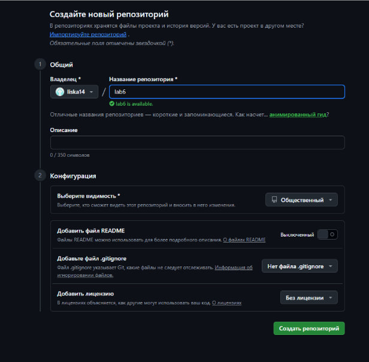
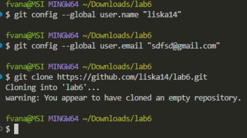
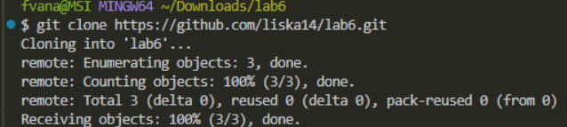
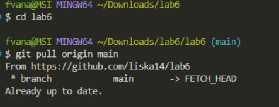
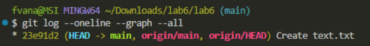
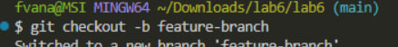
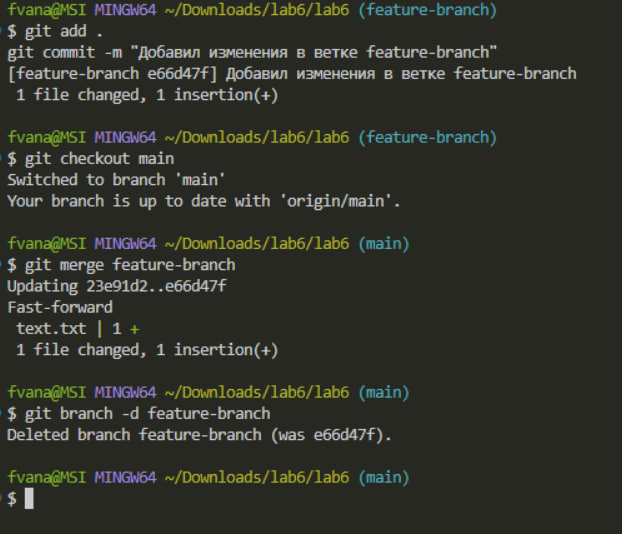
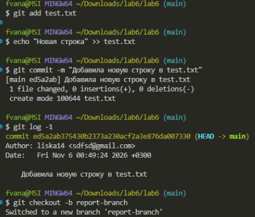
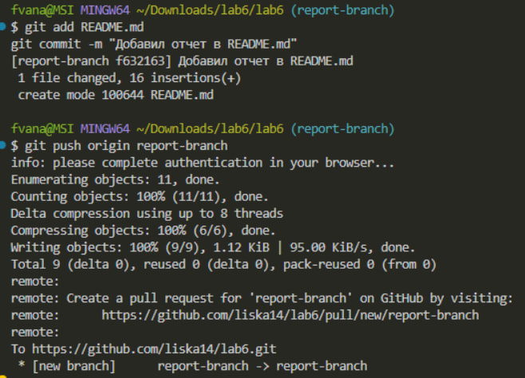

Лабораторная работа №6
Система контроля версий
Выполнила: Колязева Е., группа 4511в

Цель работы
Изучение базовых возможностей системы управления версиями, опыт работы с Git Api, опыт работы с локальным и удаленным репозиторием.

1. Задание на выполнение практической работы
Создать аккаунт GitHub

Выполнить Fork исходного репозитория

Установить и настроить Git

Выполнить клонирование удалённого репозитория

Добавить файл через интерфейс GitHub

Выполнить синхронизацию локального репозитория с GitHub с помощью git pull

Создать дополнительную ветку

Выполнить изменения и создать коммиты

Выполнить слияние веток и разрешить конфликт

Удалить дополнительную ветку

Выполнить несколько последовательных коммитов

Выполнить откат последнего коммита с помощью git revert

Создать ветку report для оформления отчёта

2. Выполнение работы
2.1 Создание аккаунта на GitHub и копирование в личное хранилище
Был создан аккаунт GitHub и новый публичный репозиторий lab6.

2.2 Настройка Git
После установки Git были настроены имя пользователя и электронная почта. Использовались команды:

git config --global user.name "liska14"
git config --global user.email "sdfsd@gmail.com"

Результат показан на рисунке 2.

2.3 Клонирование удаленного репозитория
Личный удалённый репозиторий был склонирован на локальный компьютер. Использовалась команда: git clone https://github.com/liska14/lab6.git. После клонирования было проверено состояние репозитория:

git pull origin main

Результат показан на рисунке 3.

2.4 Просмотр истории операций
Для просмотра истории изменений была использована команда: git log --oneline --graph --all.

2.5 Создание дополнительной ветки
Для работы была создана и выбрана новая ветка feature-branch:

git checkout -b feature-branch

2.6 Внесение изменений и слияние веток
В ветке feature-branch были внесены изменения в файл test.txt и создан коммит:

git add .
git commit -m "Добавил изменения в ветке feature-branch"

Затем был выполнен переход обратно в основную ветку main и произведено слияние:

git checkout main
git merge feature-branch

После успешного слияния дополнительная ветка была удалена:

git branch -d feature-branch

2.7 Создание последовательных коммитов
Для демонстрации работы с историей был изменен файл test.txt, после чего изменения были зафиксированы:

git add test.txt
echo "Новая строка" >> test.txt
git commit -m "Добавил новую строку в test.txt"

История последнего коммита была просмотрена командой:

git log -1

2.8 Создание ветки для отчета
Для оформления отчета была создана отдельная ветка report-branch:

git checkout -b report-branch

2.9 Добавление отчета и отправка на GitHub
В созданной ветке был добавлен файл с отчетом README.md, зафиксирован коммитом и отправлен в удаленный репозиторий:

git add README.md
git commit -m "Добавил отчет в README.md"
git push origin report-branch

3. Лог команд
git config --global user.name "liska14"
git config --global user.email "sdfsd@gmail.com"
git clone https://github.com/liska14/lab6.git
git pull origin main
git log --oneline --graph --all
git checkout -b feature-branch
git add .
git commit -m "Добавил изменения в ветке feature-branch"
git checkout main
git merge feature-branch
git branch -d feature-branch
git add test.txt
echo "Новая строка" >> test.txt
git commit -m "Добавил новую строку в test.txt"
git log -1
git checkout -b report-branch
git add README.md
git commit -m "Добавил отчет в README.md"
git push origin report-branch

4. История операций
Для получения истории операций в требуемом формате была использована команда:

8db8eb2 | 2026-11-20 | liska14 | Исправил форматирование
d86fe5c | 2026-11-20 | liska14 | .
e09e9f5 | 2026-11-20 | liska14 | Разрешил конфликт в README.md
68696af | 2026-11-20 | liska14 | Добавил отчет и скриншоты
f632163 | 2026-11-06 | liska14 | Добавил отчет в README.md
ed5a2ab | 2026-11-06 | liska14 | Добавила новую строку в test.txt
e66d47f | 2026-11-06 | liska14 | Добавил изменения в ветке feature-branch
23e91d2 | 2026-11-06 | liska14 | Create text.txt

Вывод
В ходе выполнения лабораторной работы были изучены базовые возможности системы управления версиями Git. Я научилась создавать и настраивать репозитории, клонировать их на локальный компьютер, работать с ветками и выполнять их слияние. Также были отработаны навыки создания коммитов, просмотра истории изменений и отправки готового отчета на удаленный сервер GitHub. Полученные знания позволяют эффективно контролировать версии файлов и безопасно вносить изменения в проект.